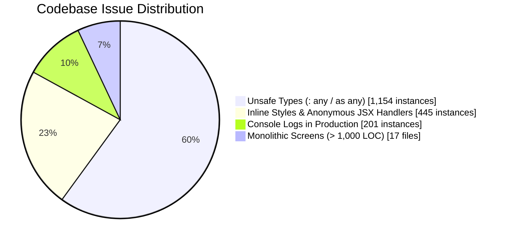
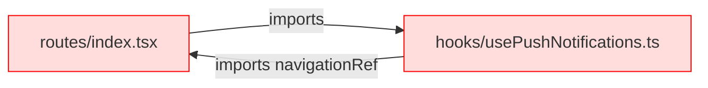
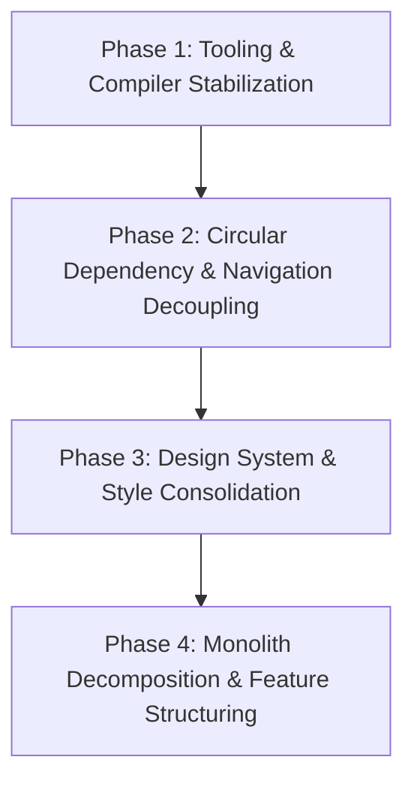

# VedicConnect Mobile App: Code Quality Audit & Remediation Plan

---

## 1. Executive Summary & Quality Scorecard

An automated and structural audit was conducted across all **410 TypeScript/TSX source files** (~**110,104 lines of code**) in the repository. While the application possesses a functional feature set (video consultations, ABDM/ABHA integration, appointments, and dietetics), significant architectural drift and technical debt have accumulated.



### Health Scorecard

| Assessment Domain                   | Grade  |   Status    | Key Metric / Observation                                                                                          |
| :---------------------------------- | :----: | :---------: | :---------------------------------------------------------------------------------------------------------------- |
| **Type Safety & Strictness**        | **D**  | ⚠️ Critical  | `"strict": false`; `tsc --noEmit` broken by TS config conflict; **1,154** `any` usages.                           |
| **Component Architecture**          | **D+** | ⚠️ High Risk | **17 screens/hooks > 1,000 LOC**; single components handle form state, PDF, Canvas, and API calls.                |
| **Directory & Structure**           | **C-** | ⚠️ Moderate  | Split between `views/screens/`, `hooks/`, and `api/`; utilities hidden inside `views/screens/functions/`.         |
| **Barrel Files & Dependency Graph** | **B-** | 🟡 Improving | 38 pseudo-barrel files recently resolved; **2 circular dependency cycles** remain via `navigationRef`.            |
| **Design System & Styling**         | **C**  | ⚠️ Moderate  | Parallel color systems (`GlobalColors` vs `ColorPalette`); 206 inline `style={{}}` instances.                     |
| **Linting & Testing Hygiene**       | **F**  |  🚨 Blocked  | `npm run lint` fails (missing ESLint config); `npm test` fails (unmocked native modules); 0 unit tests in `src/`. |

---

## 2. Directory Structure & Separation of Concerns

### Current Layout
```
src/
├── api/                   # API clients, axios instance, endpoints, AND useAbha/useAuth hooks
├── assets/                # Fonts, images, JSON language strings
├── atoms/                 # Jotai state atoms
├── components/            # Reusable UI elements, modals, containers
├── config/                # Environment variables
├── constants/             # ColorPalette, common dimensions
├── hooks/
│   ├── mutations/         # Mutation hooks (duplicates some from api/hooks)
│   └── queries/           # Query hooks
├── routes/                # Navigation stacks and tabs
├── types/                 # Interfaces and types
└── views/
    └── screens/           # All application screens
        ├── BottomTabs/
        ├── DoctorBottomTabs/
        ├── Preconsultation/
        ├── Welcome/
        └── functions/     # ⚠️ Utility functions and global colors placed inside screens!
```

### Key Structural Issues

1. **Fractured API & Hook Layers**:
   - Network logic is split arbitrarily:
     - `src/api/hooks/useAuth.ts` vs `src/hooks/mutations/index.ts`
     - `src/api/services/abha.service.ts` vs `src/hooks/mutations/useVerifyAbhaOtp`
   - Developers cannot easily tell whether to import from `src/api/hooks` or `src/hooks/mutations`.

2. **Misplaced Utilities in `src/views/screens/functions/`**:
   - `responsiveFonts.ts`, `util.ts`, `globalColors.ts`, and `refetchQuery.ts` are located in `src/views/screens/functions/`.
   - Non-UI system utilities should reside in `src/utils/` at the root of `src/`.

3. **Violation of Feature-First Architecture (Rule 17)**:
   - Screens are categorized by presentation type (`BottomTabs`, `DoctorBottomTabs`) rather than domain feature (`auth`, `appointments`, `abha`, `chat`, `profile`).
   - A single feature's logic (e.g., ABHA) is scattered across `src/views/screens/Welcome/ABHAForm`, `src/views/screens/DoctorBottomTabs/AbhaMedicalHistory`, `src/api/services/abha.service.ts`, and `src/hooks/mutations/`.

4. **Circular Dependencies via `navigationRef`**:
   - Circular imports exist:
     - `src/routes/index.tsx` &harr; `src/hooks/usePushNotifications.ts`
     - `src/routes/index.tsx` &harr; `src/views/screens/BottomTabs/VideoCall/VideoCallScreen.tsx`
   - **Root Cause**: `navigationRef` is declared and exported inside `src/routes/index.tsx`, which also imports the stacks and screens.



---

## 3. Type Safety & TypeScript Configuration

### 1. Broken Typecheck (`tsc --noEmit`)
In [`tsconfig.json`](file:///home/prologic/Documents/apps/VedicConnectmobile-app/tsconfig.json):
```json
{
  "extends": "@react-native/typescript-config",
  "compilerOptions": {
    "strict": false,
    "moduleResolution": "node"
  }
}
```
- `@react-native/typescript-config` injects `customConditions`, which requires `moduleResolution: "bundler"`, `"node16"`, or `"nodenext"`.
- Because `"moduleResolution": "node"` is explicitly set, running `tsc --noEmit` produces:
  > `error TS5098: Option 'customConditions' can only be used when 'moduleResolution' is set to 'node16', 'nodenext', or 'bundler'.`
- **Result**: The team currently has no automated compile-time type verification in local development or CI.

### 2. Pervasive `any` Usage (1,154 instances)
- Across 410 files, `: any`, `as any`, and `<any>` appear over **1,150 times**.
- Common patterns observed:
  ```typescript
  // Typical anti-pattern found across screens:
  const MyComponent = ({ navigation, route }: any) => { ... }
  const handleSuccess = (res: any) => { ... }
  ```
- This negates TypeScript's protection and allows runtime property access crashes (`TypeError: Cannot read property 'x' of undefined`).

---

## 4. Barrel Files & Import Strategies

### Audit Status
- **Progress**: 38 pseudo-barrel files (`index.tsx` acting as 1,000+ line component definitions) have recently been converted to clean named component files (`<Component>.tsx`) + light 2-line re-exporters (`export { default } from './...';`).
- **Remaining Concern**:
  - In large directories like `src/hooks/mutations/index.ts` (109 lines), barrel re-exports can trigger large import trees during bundling and testing.
  - Sub-modules should prefer clean, direct imports or granular feature barrels rather than giant global catch-alls.

---

## 5. File & Folder Naming Inconsistencies

1. **Abbreviation Inconsistencies**:
   - `AddUpdateFamMember.tsx` uses `Fam` while its navigation name and types use `AddUpdateFamilyMember`.
   - `BookAppointments/` (plural) vs `BookingAppointment` in some references.
   - `DocBottomTabs.tsx` vs `BottomTabs.tsx`.

2. **Inconsistent Component Directory Structures**:
   - Some screens have a dedicated directory with a sub-component hierarchy (e.g., `src/views/screens/BottomTabs/Appointments/screens/UpcomingScreen.tsx`).
   - Others sit directly at root levels without encapsulation (e.g., `src/views/screens/Preconsultation/FoodHabits.tsx`).

3. **Casing & Trailing Space Hazards**:
   - Earlier cleanup resolved `DoctorFormScreen ` (a folder created with a trailing space). Strict linting should enforce consistent kebab-case or PascalCase naming.

---

## 6. Component Architecture & Function Sizing

### Oversized "God Files" (> 1,000 LOC)

| File Path                                                                                                                                                                                              |    LOC    | Core Responsibilities Packed into One File                                                                                                                           |
| :----------------------------------------------------------------------------------------------------------------------------------------------------------------------------------------------------- | :-------: | :------------------------------------------------------------------------------------------------------------------------------------------------------------------- |
| [`AddAndEditPrescription.tsx`](file:///home/prologic/Documents/apps/VedicConnectmobile-app/src/views/screens/DoctorBottomTabs/DoctorProfile/screens/AddAndEditPrescription/AddAndEditPrescription.tsx) | **2,666** | Formik form, HTML template generation, WebView rendering, Signature Canvas, file picker, medicine array mutations, validation logic.                                 |
| [`usePushNotifications.ts`](file:///home/prologic/Documents/apps/VedicConnectmobile-app/src/hooks/usePushNotifications.ts)                                                                             | **2,109** | FCM foreground & background listeners, VoIP push tokens, CallKeep setup & event dispatching, ringtone audio player, Android notification channels, chat queue atoms. |
| [`PracticeDetails.tsx`](file:///home/prologic/Documents/apps/VedicConnectmobile-app/src/views/screens/DoctorBottomTabs/DoctorProfile/screens/PracticeDetails/PracticeDetails.tsx)                      | **1,760** | Clinic address, consultation fees, banking details, file uploads, multiple modals, Formik schema validation.                                                         |
| [`DoctorAppointmentScreen.tsx`](file:///home/prologic/Documents/apps/VedicConnectmobile-app/src/views/screens/DoctorBottomTabs/DoctorAppointmentScreen/DoctorAppointmentScreen.tsx)                    | **1,642** | Tab switching, appointment filtering, search logic, card rendering, call actions, appointment status mutations.                                                      |
| [`BookAvailableDoctor.tsx`](file:///home/prologic/Documents/apps/VedicConnectmobile-app/src/views/screens/BottomTabs/BookAppointments/screens/BookAvailableDoctor.tsx)                                 | **1,517** | Doctor info header, calendar date picker, slot calculation, patient selection modal, pricing calculation.                                                            |
| [`DietPlan.tsx`](file:///home/prologic/Documents/apps/VedicConnectmobile-app/src/views/screens/DoctorBottomTabs/DoctorAppointmentScreen/DietPlan.tsx)                                                  | **1,511** | Meal slot configurations, calorie tracking inputs, multi-day meal plans, Formik arrays.                                                                              |
| [`ProceedPayScreen.tsx`](file:///home/prologic/Documents/apps/VedicConnectmobile-app/src/views/screens/BottomTabs/BookAppointments/screens/ProceedPayScreen.tsx)                                       | **1,474** | Razorpay SDK integration, ABHA linking trigger, discount coupon validation, family member selector.                                                                  |

### Component Code Smells

1. **Anonymous Handlers in JSX (239 instances)**:
   - Violates Rule 8 (`Avoid anonymous functions inside JSX. Use useCallback for handlers`).
   - Example: `<TouchableOpacity onPress={() => navigation.navigate(...)}>` creates a new function instance on every render cycle, triggering unnecessary re-renders of child trees.

2. **Inline Styles (206 instances)**:
   - Violates Rule 6 (`Use StyleSheet.create() for component styles`).
   - Allocates new objects on the heap during render passes, contributing to GC thrashing and frame drops.

---

## 7. Styling & Design System Fragmentation

### 1. Dual Color Systems
The codebase currently imports colors from two competing sources:
- [`src/constants/colorPalette.ts`](file:///home/prologic/Documents/apps/VedicConnectmobile-app/src/constants/colorPalette.ts): Modern structured semantic tokens (`ColorPalette.brand.primary`, `ColorPalette.backgroundAndNeutral`).
- [`src/views/screens/functions/globalColors.ts`](file:///home/prologic/Documents/apps/VedicConnectmobile-app/src/views/screens/functions/globalColors.ts): Flat, legacy object with duplicated or conflicting hex codes.

### 2. Hardcoded Values
- Over **1,200 instances** of literal hex strings (`#FFFFFF`, `#000`, `#37865F`, `#1F6F63`) are scattered throughout component stylesheets instead of referencing `ColorPalette`.
- Arbitrary margin/padding numbers (`padding: 13`, `marginHorizontal: 17`) bypass standard spacing scales.

---

## 8. Tooling, Linting & Testing Hygiene

1. **Broken Linter**:
   - `package.json` specifies `"lint": "eslint ."`.
   - Running `npm run lint` yields:
     > `ESLint couldn't find a configuration file.`
   - No `.eslintrc.js` exists in the repository root.

2. **Broken Jest Test Harness**:
   - Running `npm test` fails immediately:
     > `Notifee native module not found.`
   - Jest setup does not mock native modules (`@notifee/react-native`, `react-native-callkeep`, `react-native-keychain`).
   - There are **0 unit or integration tests** in `src/`.

3. **Stray Logging in Production**:
   - **201** raw `console.log` statements are present across `src/`, exposing user data and degrading JavaScript bridge throughput.

---

## 9. Actionable Remediation Roadmap



### Phase 1: Tooling & Compiler Stabilization (Immediate / 1–2 Days)
- [ ] **Fix `tsconfig.json`**:
  Set compiler options so `tsc --noEmit` runs without errors:
  ```json
  {
    "extends": "@react-native/typescript-config",
    "compilerOptions": {
      "jsx": "react-native",
      "module": "esnext",
      "moduleResolution": "bundler",
      "target": "esnext",
      "lib": ["es2020"],
      "allowJs": true,
      "skipLibCheck": true,
      "strict": false,
      "noEmit": true
    }
  }
  ```
- [ ] **Configure `.eslintrc.js`**:
  Create `.eslintrc.js` extending `@react-native/eslint-config`. Add rules to ban `console.log` in production and enforce `useCallback`.
- [ ] **Fix Jest Native Mocks**:
  Create `jest.setup.js` with mocks for `@notifee/react-native`, `RNCallKeep`, and `react-native-keychain`.

### Phase 2: Circular Dependency & Navigation Decoupling (2–3 Days)
- [ ] **Extract `navigationRef`**:
  Move `createNavigationContainerRef()` from `src/routes/index.tsx` into an isolated `src/routes/navigationRef.ts`.
  Update `usePushNotifications.ts` and `VideoCallScreen.tsx` to import from `./navigationRef`.
  *This eliminates both circular dependency cycles.*

### Phase 3: Design System & Styling Consolidation (3–5 Days)
- [ ] **Retire `GlobalColors.ts`**:
  Migrate all imports of `GlobalColors` to `ColorPalette`. Deprecate `src/views/screens/functions/globalColors.ts`.
- [ ] **Move `functions/` to `src/utils/`**:
  Move `src/views/screens/functions/util.ts` &rarr; `src/utils/util.ts`.
  Move `src/views/screens/functions/responsiveFonts.ts` &rarr; `src/utils/responsiveFonts.ts`.

### Phase 4: Monolith Decomposition & Feature Structuring (Ongoing)
- [ ] **Decompose `usePushNotifications.ts` (2,109 LOC)**:
  Split into 3 focused services:
  1. `CallKeepService.ts` (VoIP call initialization, ringtone, and event listeners).
  2. `FcmNotificationService.ts` (FCM messaging, token registration, background handlers).
  3. `NotificationRouter.ts` (mapping notification payloads to navigation screens).
- [ ] **Decompose `AddAndEditPrescription.tsx` (2,666 LOC)**:
  Extract sub-components into separate files:
  1. `MedicineListSection.tsx`
  2. `DiagnosisInputSection.tsx`
  3. `DigitalSignatureModal.tsx`
  4. `PrescriptionHtmlBuilder.ts`
